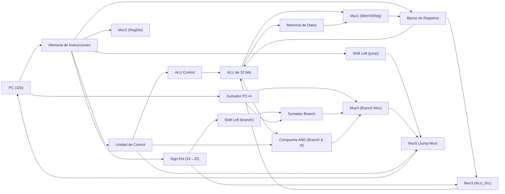

# Arquitectura RTL del Datapath MIPS de 32 bits (Diapositiva 17)

**Seminario de Solución de Problemas de Arquitectura de Computadoras**  
**Universidad de Guadalajara · CUCEI**

---

## 🏛️ Descripción General

El procesador implementado corresponde a una arquitectura monociclo basada en el diseño clásico de David A. Patterson y John L. Hennessy, específicamente la versión integrada de la **Diapositiva 17 ("Datapath Completo")**. En esta arquitectura, cada instrucción se ejecuta en un único ciclo de reloj (`CPI = 1`), coordinando el flujo de datos entre 18 componentes funcionales interconectados mediante buses de datos, direcciones y líneas de control.

---

## 🧩 Los 18 Componentes del Datapath

| # | Componente | Entradas Principales | Salidas Principales | Función RTL |
| :-: | :--- | :--- | :--- | :--- |
| **1** | **PC** | `CLK`, `rst`, `next_pc [31:0]` | `PC [31:0]` | Registro de 32 bits que contiene la dirección de la instrucción en curso. |
| **2** | **Sumador PC+4** | `PC [31:0]`, `4` | `PC+4 [31:0]` | Suma 4 bytes al PC para obtener la dirección secuencial siguiente. |
| **3** | **Memoria de Instrucciones** | `addr [31:0]` | `instruction [31:0]` | Memoria ROM que entrega la palabra de instrucción de 32 bits. |
| **4** | **Unidad de Control** | `op [31:26]` | `en_BR`, `RegDst`, `ALU_Src`, `ALU_Op`, `MemToReg`, `MemRead`, `MemWrite`, `Branch`, `Jump` | Decodificador central que genera las 9 señales de control. |
| **5** | **Mux2 (RegDst)** | `rt [20:16]`, `rd [15:11]`, `RegDst` | `AW [4:0]` | Selecciona el registro de destino en el banco de registros. |
| **6** | **Banco de Registros** | `AR1 [25:21]`, `AR2 [20:16]`, `AW [4:0]`, `DW [31:0]`, `en_BR`, `CLK` | `DR1 [31:0]`, `DR2 [31:0]` | Contiene 32 registros de 32 bits ($zero a $ra) con lectura asíncrona y escritura sincrónica. |
| **7** | **Sign Ext** | `in [15:0]` | `out [31:0]` | Extiende el inmediato de 16 bits con signo a 32 bits. |
| **8** | **Mux3 (ALU_Src)** | `DR2 [31:0]`, `SignExt [31:0]`, `ALU_Src` | `B [31:0]` | Selecciona el segundo operando que entra a la ALU. |
| **9** | **ALU** | `A [31:0]`, `B [31:0]`, `alu_ctrl [2:0]` | `result [31:0]`, `zf` | Realiza operaciones aritméticas/lógicas y activa `zf = (result == 0)`. |
| **10** | **ALU Control** | `ALU_Op [1:0]`, `funct [5:0]` | `alu_ctrl [2:0]` | Decodifica la operación exacta de la ALU según funct y ALU_Op. |
| **11** | **Memoria de Datos** | `Address_In [31:0]`, `Data_In [31:0]`, `MemRead`, `MemWrite`, `CLK` | `Lectura [31:0]` | Memoria RAM para lectura (lw) y escritura (sw) de datos. |
| **12** | **Mux1 (MemToReg)** | `ALU_Result [31:0]`, `Lectura [31:0]`, `MemToReg` | `DW [31:0]` | Elige qué dato se escribe en el Banco de Registros. |
| **13** | **Shift Left (branch)** | `SignExt [31:0]` | `Shifted [31:0]` | Desplaza 2 bits a la izquierda el offset para alinearlo a palabras (*4). |
| **14** | **Sumador de Branch** | `PC+4 [31:0]`, `Shifted [31:0]` | `Branch Target [31:0]` | Calcula la dirección destino de la bifurcación relativa al PC. |
| **15** | **Compuerta AND** | `Branch`, `zf` | `PCSrc` | Evalúa si la condición de salto se cumple (`Branch AND zf`). |
| **16** | **Mux4** | `PC+4 [31:0]`, `Branch Target [31:0]`, `PCSrc` | `Mux4_Out [31:0]` | Selecciona entre continuar secuencialmente o tomar el branch. |
| **17** | **Shift Left (jump)** | `target [25:0]` | `JumpAddr [27:0]` | Multiplica por 4 el campo target de salto incondicional. |
| **18** | **Mux5** | `Mux4_Out [31:0]`, `{PC+4[31:28], JumpAddr}`, `Jump` | `next_pc [31:0]` | Selecciona la dirección final que se cargará en el PC. |

---

## 📊 Matriz de Señales de Control

| Instrucción | Tipo | RegDst | ALU_Src | MemToReg | en_BR | MemRead | MemWrite | Branch | ALU_Op | Jump |
| :--- | :-: | :-: | :-: | :-: | :-: | :-: | :-: | :-: | :-: | :-: |
| **Tipo R (add, sub...)** | R | `1` | `0` | `0` | `1` | `0` | `0` | `0` | `10` | `0` |
| **lw (Load Word)** | I | `0` | `1` | `1` | `1` | `1` | `0` | `0` | `00` | `0` |
| **sw (Store Word)** | I | `X` | `1` | `X` | `0` | `0` | `1` | `0` | `00` | `0` |
| **beq (Branch Equal)** | I | `X` | `0` | `X` | `0` | `0` | `0` | `1` | `01` | `0` |
| **j (Jump)** | J | `X` | `X` | `X` | `0` | `0` | `0` | `0` | `XX` | `1` |
